# 数据-物理驱动的鄂尔多斯盆地岩石圈三维热结构建模

## 课题总结报告

## 一、概述

### **1. 研究背景与意义**

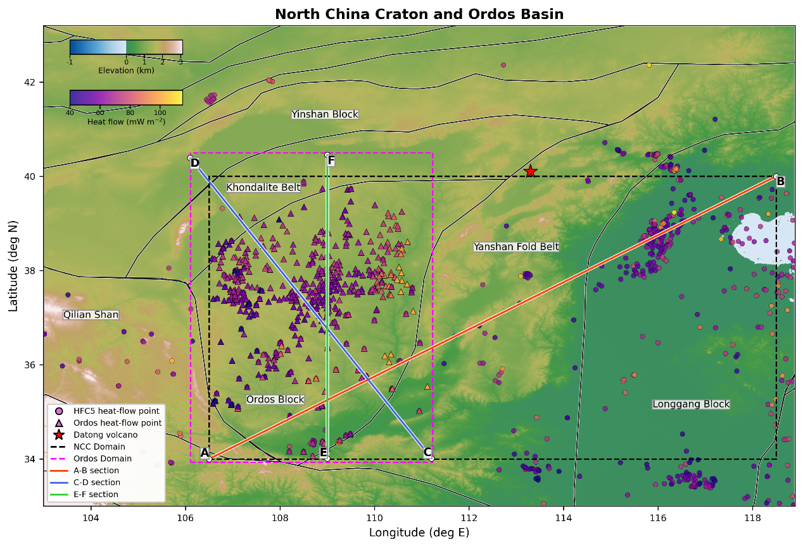

图 1 研究区位置、热流观测点及A-B、C-D、E-F剖面位置

鄂尔多斯盆地位于华北克拉通西部，是经历多期构造改造叠加的大型陆内盆地(Gao et al., 2018)，北接孔兹岩带与阴山地块，东邻燕山造山带，西南临近祁连山（图 1）。与华北克拉通东部广泛减薄、强烈改造的岩石圈相比，鄂尔多斯块体整体保存了较稳定、较厚的克拉通本体(Zhang et al., 2025; Yang et al., 2025)。然而，地震波速(Yan et al., 2019; Zhang et al., 2022)、电性结构(Shi et al., 2022)、重磁异常(Fullea et al., 2008)和地表热流(Qi et al., 2025)等资料显示，盆地边缘并非均一，南缘渭北隆起、东缘晋西褶皱冲断带以及西缘天环坳陷一带均存在不同程度的深部热异常，提示克拉通改造的影响可能已延伸至盆地内部(Hao et al., 2025)。

岩石圈温度场是连接浅部沉积—成藏过程与深部动力学过程的关键物理量，直接影响有机质成熟度、油气保存条件(Yang P et al., 2024)、地壳流变学强度(Wang et al., 2020)以及地震波速和电阻率等观测响应。因此，建立具有横向非均质性约束的三维热结构模型，不仅有助于解释盆地内部与周缘的热状态差异，也可为华北克拉通西部岩石圈是否被改造、改造边界位于何处等问题提供地热学证据。然而，受限于传统热结构建模方法对横向非均质性的表达能力(Gao et al., 2018)，区域岩石圈热异常的空间展布、垂向延伸以及深浅部热源贡献的定量关系仍不清楚。

### **2. 国内外研究现状**

鄂尔多斯盆地热状态的研究已积累了较丰富的基础。(Qi et al., 2025)汇编了最新钻井数据，给出了浅层地温梯度均值28 K/km、地表热流均值62 mW/m²的区域特征；(黄方 等, 2015)通过数值模拟揭示了盆地"热壳冷幔"的热流分配模式；(Yan et al., 2019)基于地震波速反演了上地幔三维温度场。但上述研究多局限于二维剖面或单一数据源，对盆地三维热结构的横向非均质性刻画尚不充分。

在方法层面，多观测耦合反演已成为岩石圈三维结构建模的重要方向。(Afonso et al., 2013)提出的LitMod框架将重力、地形、地震波速等观测统一到热—化学框架下联立约束，有效减轻了单一资料反演的多解性。(Guo et al., 2016; Zhang et al., 2025; Yang et al., 2025; Li et al., 2026) 将多种观测纳入该框架建立了华北克拉通三维热—化学模型，结果显示鄂尔多斯块体仍保存较厚的克拉通根，而东部岩石圈已明显减薄。与此同时，物理信息神经网络（PINN）在地热建模中的应用迅速兴起。多项研究表明物理方程约束下融合多源地球物理数据可显著改善观测稀疏区的温度预测精度，并为不确定性评估提供了新路径(Ishitsuka et al., 2025; Aljubran et al., 2024; Shima et al., 2024)。这些工作表明数据-物理融合建模策略在岩石圈热结构领域具有广阔前景，但尚未在中国稳定克拉通及其改造边界的研究中得到系统应用。

### **3. 研究目标与技术路线**

本研究的目标是建立鄂尔多斯盆地三维岩石圈热结构模型，定量刻画盆地内部及边缘的温度场、热流场和热物性分布，并据此分析壳幔热流分配格局与岩石圈热改造情况。

研究采取分阶段推进的策略。第一阶段为方法验证，华北克拉通东西向岩石圈性质差异显著，热结构对比信号明确，加之区内地球物理观测资料丰富，是检验数据-物理融合建模方法的理想区域。因此，本阶段在华北克拉通整体范围内构建PINN正演模型，将三维稳态热传导方程与多源地球物理观测融合，验证该方法能否重建已知的东西向热结构差异，并借助SHAP可解释性分析各类输入数据的贡献是否符合岩石物理认知。第二阶段为精细反演，该阶段聚焦鄂尔多斯盆地，开发参数化反演模型HeatSolver，以可微分有限差分求解器为基础，将热导率、生热率和底部温度边界作为可反演参数，通过地表热流拟合与多源数据正则化联合约束，获得具有不确定性估计的三维热结构。两阶段模型使用同一控制方程和多源数据体系，但PINN侧重于大区域正演验证与特征重要性分析，而HeatSolver侧重盆地尺度参数反演与热流分配定量分解。

研究中设置了三条剖面（图1）：A-B剖面自鄂尔多斯地块向东北横跨燕山造山带至龙岗地块，用于检验华北克拉通东西向热结构差异；C-D剖面自东南向西北穿过渭北隆起、伊陕斜坡、天环坳陷和伊盟隆起，用于分析盆地内部构造单元的深部热状态；E-F剖面为盆地内近南北向浅部剖面，重点考察沉积盖层对浅层温度梯度的调节作用。

## 二、课题研究的主要内容与重点

### **1. 控制方程与数据基础**

#### **1.1 三维稳态热传导方程**

本研究的模型均以稳态热传导为基本物理假设，在忽略对流和瞬态热扰动的条件下，岩石圈内部温度$T$满足

$$\nabla \cdot [k(x,y,z,T)\nabla T(x,y,z)] + A(x,y,z)=0$$

其中$k$为热导率（W m⁻¹ K⁻¹），$A$单位体积放射性生热率（W m⁻³）。在深度$z$向下为正的坐标系中，地表向上的热流定义为

$$q_s(x,y)=k(x,y,0,T)\left.\frac{\partial T}{\partial z}\right|_{z=0}\times10^3$$

单位为 mW m⁻²。边界条件设定为，地表给定温度$T_s(x,y)$，模型底部（LAB深度或120 km深度）给定温度$T_b(x,y)$，四周侧边界采用零法向热流条件。

#### **1.2 热物性参数设定**

热导率和生热率的空间分布是控制温度场的关键参数。PINN中地壳与沉积层热导率引入温度和压力依赖性

$$k_{\mathrm{crust}}=k_0\frac{1+ch}{1+b_r(T-293.15)}$$

其中$h$为相对地表深度，$c=1.5\times10^{-6}$m⁻¹ 为压力修正系数，$b_r$为温度系数，沉积层/上地壳、中地壳和下地壳分别取约$1.0\times10^{-3}$、$5.0\times10^{-4}$和$1.5\times10^{-4}$ K⁻¹ (Sun et al., 2022)。上地幔热导率采用晶格导热和辐射导热的组合表达(Donald L. et al., 2002)：

$$k_{\mathrm{mantle}}=k_0\,1.23\times10^{-10}T^3+\frac{1}{0.518+7.89\times10^{-4}T}$$

生热率在浅部保持较高值，13 km以下按指数衰减(Sun et al., 2022)：

$$A(h)=\begin{cases}A_0,&h<D_0,\\A_0\exp\left(-\frac{h-D_0}{D_1}\right),&h\ge D_0,\end{cases}\qquad D_0=D_1=13\,\mathrm{km}$$

HeatSolver中热导率写作$k=K_0/\max(1+cT,0.1)$的简化形式以增强数值稳定性，上地壳生热率参考值为$A(h)=A_0\exp(-h/D)$，两个参数由分层参考值与反演乘子共同确定（详见2.4节）。各层位参考热物性参数如表1所示(Qi et al., 2025; Gao et al., 2018)。

表1 分层参考热物性参数

| **层位/地层** | **A (μW m⁻³)** | **K₀ (W m⁻¹ K⁻¹)** | **温度系数 c (K⁻¹)** |
|----|----|----|----|
| **沉积层整体参考** | 1.8 | 2.3 | 0 |
| **新生界** | 1.54 | 2.00 | 0 |
| **白垩系** | 1.54 | 2.53 | 0 |
| **侏罗系** | 1.54 | 2.14 | 0 |
| **三叠系** | 1.54 | 2.32 | 0 |
| **二叠系/** | 1.69 | 2.77 | 0 |
| **石炭系** | 2.00 | 2.48 | 0 |
| **奥陶系** | 0.60 | 3.60 | 0 |
| **寒武系** | 0.97 | 3.60 | 0 |
| **上地壳** | A₀ = 1.8, D = 13 km | 2.3 | 0 |
| **中地壳** | 0.86 | 2.5 | 1.0×10⁻⁴ |
| **下地壳** | 0.25 | 2.5 | 1.0×10⁻⁴ |
| **地幔** | 0.03 | 3.4 | 0 |

#### **1.3 多源数据体系**

本研究使用的数据分为三类（表2）。第一类为热学直接约束，包括地表热流观测点(王一波 等, 2024)、钻井温度数据(Qi et al., 2025)、浅层地表温度(Zhao et al., 2019)。第二类为结构约束，包括地形(GEBCO Compilation Group (2025))、沉积层厚度及地层分层(Wang et al., 2021)、莫霍面深度(Xiao et al., 2024)、上/中/下地壳厚度(Xiao et al., 2024)和居里点深度、岩石圈底界深度(Zhang et al., 2025)，用于确定模型几何形态和分层热物性。第三类为多源地球物理特征，包括磁异常(Maus et al., 2009)、布格重力异常、自由空气重力异常(Fullea et al., 2008)、三维大地电磁（MT）电阻率(Shi et al., 2022)、地壳波速（Vp）和上地幔波速（Vs）(Xiao et al., 2024)，作为与温度相关的结构先验信息输入模型。所有数据统一重采样至计算网格并标准化处理后输入模型。

表2 数据类型及其在模型中的作用

| **数据类型** | **主要变量** | **在模型中的作用** |
|----|----|----|
| **热流与温度** | 地表热流、地表温度 | 直接约束温度梯度、热流幅值 |
| **结构界面** | 沉积底界、上/中/下地壳厚度、莫霍面、居里点深度、LAB | 确定分层热物性、限定岩石圈模型几何，约束深部等温面位置 |
| **地形** | 高程 | 表征构造边界、密度和磁性体差异 |
| **重磁** | 布格/自由空气重力异常、磁异常 |  |
| **地震波速** | Vp、Vs | 识别温度和岩石圈强度变化 |
| **电性结构** | MT电阻率 | 辅助识别与流体、熔融或热异常相关的低阻体 |

 

### **2. PINN数据-物理正演模型与华北克拉通尺度验证**

#### **2.1 方法论**

物理信息神经网络（PINN）是本研究第一阶段的建模工具，目标是检验多源地球物理观测与热传导方程融合重建岩石圈三维温度场的可行性。模型覆盖 106.5°E-118.5°E、34°N-40°N 的华北克拉通核心区域（图1），以归一化后的三维空间坐标$(x_n,y_n,z_n)$与多源地球物理特征向量

$$\mathbf{f}=[\mathrm{Elevation},\mathrm{Magnetic\ Anomaly},\mathrm{Free\!\text{-}\!air\ Anomaly},\mathrm{Bouguer\ Anomaly},\mathrm{Resistivity},V_p,V_s]$$

为输入，温度$T$为输出。网络采用三层全连接结构，每层64个神经元，激活函数为tanh，输出形式为$T=T_0+\Delta T\tanh\theta$，其中 $T_0=800$K、$\Delta T=1000$K，确保输出处于地球物理合理范围。

损失函数包含四部分：PDE残差损失（式1在内部物理点上的均方残差）、温度约束损失（地表10℃、居里点580℃、LAB 1300℃）、热流约束损失（约束地表及等温面深度处的垂向热流）和K近邻梯度平滑损失（抑制非物理振荡）。训练采用两阶段策略：Adam优化器训练约1000轮快速收敛，L-BFGS精调约200轮提高拟合精度。

为检验模型预测的地球物理合理性，引入SHAP（SHapley Additive exPlanations）(Lundberg et al., 2017)方法，量化各输入特征对温度和热流预测的边际贡献，检验贡献方向是否符合岩石物理认知。

#### **2.2 结果与验证**

PINN模型在华北克拉通范围内重建的三维温度场在垂向结构、横向分异和特征响应三个层面均与已有地质认识一致，表明数据-物理融合建模的思路是可行的。

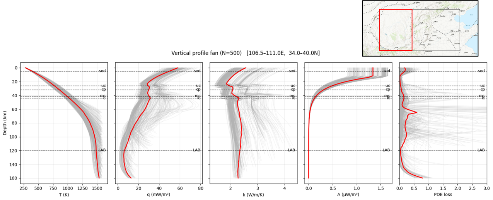

图 2鄂尔多斯盆地温度、热流、热导率、生热率和PDE损失垂向剖面，红线为平均剖面

**垂向结构：**鄂尔多斯区域内500条垂向剖面（图 2）显示，温度从地表约300 K单调升高至160 km深度的1500 K以上，热流在浅部较高并随深度衰减，热导率和生热率均呈现合理的分层特征。浅部温度曲线集中而深部离散性增大，说明深部热结构对横向非均质性更敏感。PDE残差整体较小，表明网络输出较好地满足了稳态热传导方程约束。

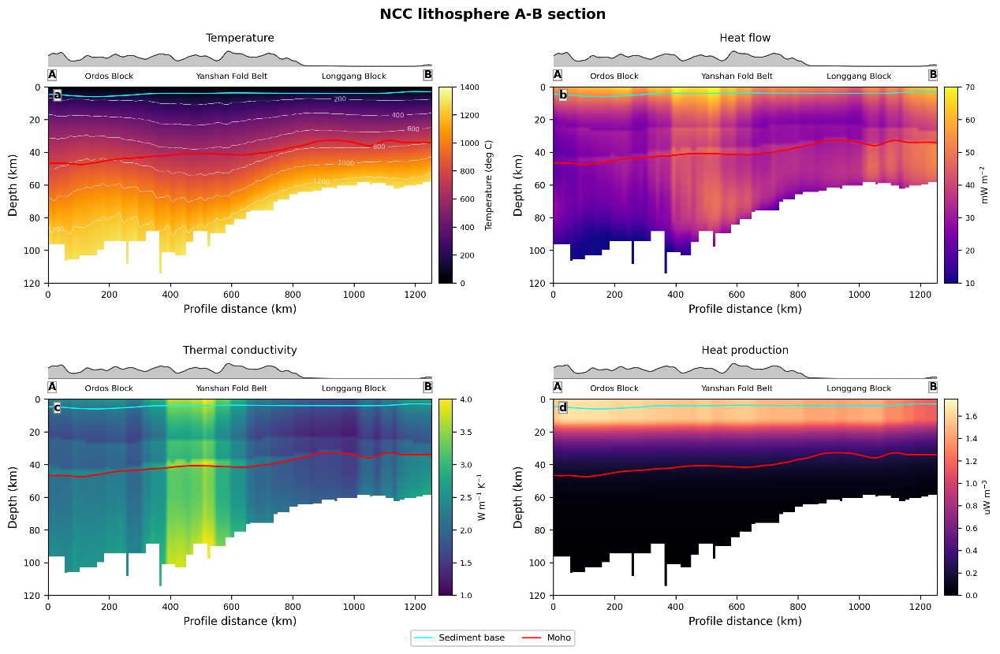

图 3 华北克拉通A-B温度、热流、热导率和生热率剖面，红线为莫霍面，青线为沉积层底界

**横向结构：**A-B剖面（图 3）清楚地展现了华北克拉通东西向热结构差异。鄂尔多斯块体等温线平缓，呈现典型的冷厚克拉通特征；燕山褶皱带和龙岗块体段，深部等温线显著抬升，莫霍面由约45 km变浅至约35 km。生热率剖面显示浅部生热东西差异不大，说明深部等温线抬升主要受控于岩石圈厚度变化和底部热输入的横向不均一。

**SHAP特征分析：** SHAP分析（图 4）显示，Vp和Vs对温度预测贡献最为显著，高波速对应负SHAP值（降低预测温度），低波速对应正SHAP值，与高温降低岩石弹性波速的物理机制一致。布格重力异常、磁异常、电阻率和地形的整体贡献较弱，但在构造边界或局部异常区具有辅助约束价值。上述结果表明模型对多源输入的利用方式具有一定的岩石物理基础，而非单纯依赖统计拟合。

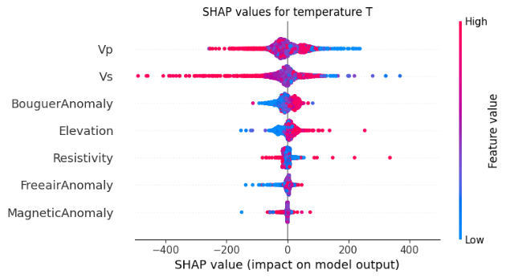

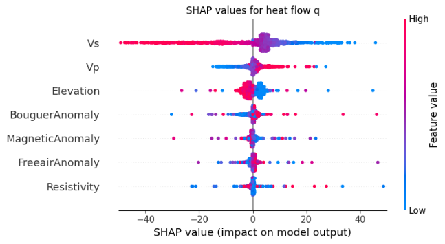

图 4 华北克拉通温度T和热流q对输入特征的SHAP beeswarm图

横轴为特征对预测值的边际贡献，颜色表示特征取值高低

综上，PINN验证了多源数据融合建模的可行性，也确认了地震波速是温度场最敏感的输入特征。但该模型将热物性参数固定于经验公式，无法进行反演，难以精确评估不同深度热源对热流的贡献，这构成了发展HeatSolver参数化反演模型的直接驱动原因。

### **3. HeatSolver参数化反演模型与鄂尔多斯盆地热结构**

#### **3.1 方法论**

HeatSolver聚焦鄂尔多斯盆地（约106.5°–111.2°E，34°–40.5°N，图1），在20 km × 20 km水平网格、2 km垂向步长、0–120 km深度范围内进行三维热结构反演。其核心设计是将反演过程分解为两个环节：多源地球物理特征通过卷积神经网络（CNN）编码为低维参数，再由可微分物理求解器将参数严格映射为温度场和地表热流，确保从参数到温度的过程完全由热传导方程控制。

HeatSolver将底部温度$T_b(x,y)$、热导率$K_0(x,y,z)$和生热率$A(x,y,z)$作为反演对象。为避免参数高自由度导致的反演不稳定，参数场采用离散余弦变换（DCT）的低频系数进行表示$m(x,y)=\mathbf{B}_y\mathbf{C}\mathbf{B}_x^T$，其中$\mathbf{C}$为低频DCT系数矩阵，$\mathbf{B}_x$、$\mathbf{B}_y$为相应的DCT基函数矩阵。底部温度写作$T_b(x,y)=T_{\mathrm{ref}}+\Delta T_b(x,y)$，$T_{\mathrm{ref}}$通常取1300 ℃，扰动量$\Delta T_b$由约$3\times3$的低频系数表示。热导率和生热率则采用分层对数乘子的形式：

$$K_0(x,y,z)=K_{0,\mathrm{ref}}(x,y,z)\exp m_K^l(x,y)$$

$$A(x,y,z)=A_{\mathrm{ref}}(x,y,z)\exp m_A^l(x,y)$$

其中$l$代表沉积层、上地壳、中地壳、下地壳和地幔五类层位，$K_{0,\mathrm{ref}}$和$A_{\mathrm{ref}}$为表1中的参考值。热导率和生热率的DCT维数分别取约$6\times6$和$8\times8$量级。网络输出经tanh激活和比例因子裁剪，确保参数扰动维持在物理合理范围内。该设计将多源信息压缩为对参考模型的平滑低维扰动，在降低多解性的同时避免了稀疏区的过拟合。

稳态热传导方程在三维网格上采用有限差分离散，层间热导率取调和平均，非线性热导率通过Picard迭代处理，线性方程组由AMG-CG求解。HeatSolver实现了PyTorch autograd接口：前向传播调用数值求解器，反向传播通过伴随方程计算参数梯度，使整个流程端到端可微。

反演目标函数为

$$\mathcal{L}=\frac{1}{2N}\sum_{i=1}^{N}\left[q_{\mathrm{pred}}(x_i,y_i)-q_{\mathrm{obs}}(x_i,y_i)\right]^2+\mathcal{L}_{\mathrm{moment}}+\mathcal{L}_{\mathrm{reg}}$$

其中第一项以地表热流拟合作为为核心约束，$\mathcal{L}_{\mathrm{moment}}$约束预测热流的均值和标准差与观测统计一致，$\mathcal{L}_{\mathrm{reg}}$为参数系数的L2正则化，防止参数偏离参考模型过远。优化器选用AdamW。为估计不确定性，通过改变随机种子、热流点划分、DCT维数和正则化权重生成多个反演成员，统计集合均值和标准差。

#### **3.2 反演结果**

##### **3.2.1 三维温度场的空间分异格局**

HeatSolver反演获得了鄂尔多斯盆地0-120 km深度的三维温度场（图 5）和沿C-D剖面的垂向热结构（图 6）。结果呈现出贯穿全深度的一阶格局：伊陕斜坡（YSS）中部始终为低温核心，等温线在各深度均向该区域凹陷，具有稳定克拉通块体特征；南缘渭北隆起（WBU）和东缘晋西褶皱冲断带（JXFFB）持续偏热，且高温异常随深度增大而愈加显著——在80-120 km深度，WBU和JXFFB的温度比YSS中部高出200-400℃，可能指示了深部热输入增强或岩石圈底部的热改造。天环坳陷（THD）和西缘冲断带（WMTB）整体偏冷，伊盟隆起（YMU）北部局部偏热但幅度有限。

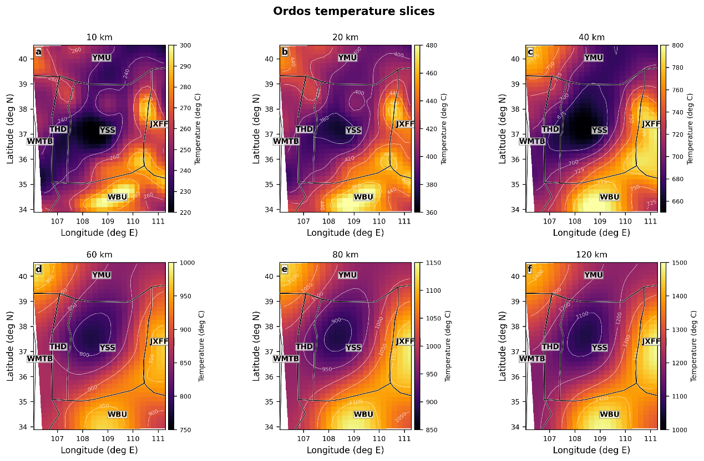

图 5鄂尔多斯盆地温度场深度切片

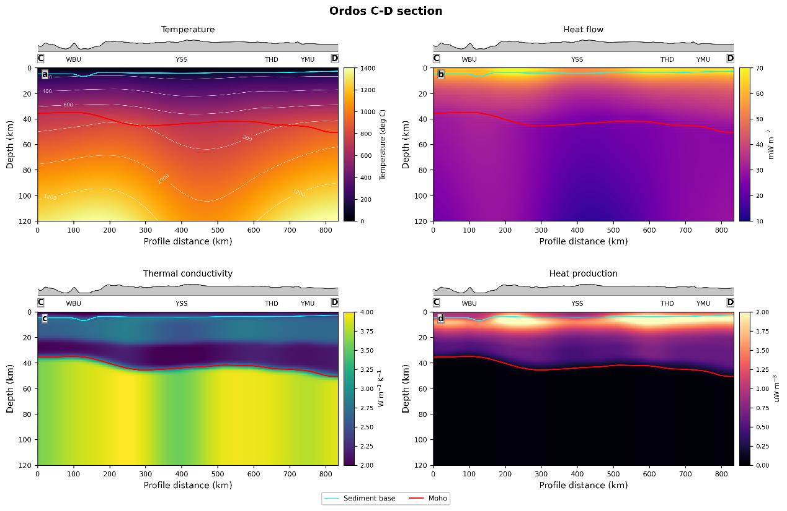

图 6 鄂尔多斯盆地C-D温度、热流、热导率和生热率剖面，红线为莫霍面，青线为沉积层底界

C-D剖面中，YSS下方800℃等温线明显下凹，WBU一侧深部等温线显著抬升。热流在地表附近形成高值带并随深度快速衰减，生热率集中在沉积层和上地壳，热导率呈跨莫霍面的阶跃式增大。上述垂向结构表明，盆地温度场受浅部放射性生热和深部底界热输入的双重控制，而二者的相对贡献在不同构造单元间存在差异。

#### **3.2.2 模型验证**

在热流拟合方面（图 7），HeatSolver预测的地表热流为55-85 mW m⁻²，均值69.3 mW m⁻²，空间分布与观测值整体一致。残差以零值为中心呈小幅正负交替，绝大部分在±10 mW m⁻²以内，无系统性偏移。集合反演给出的预测不确定性为0.5-3.5 mW m⁻²，观测密集区较低，边界和数据稀疏区较高，符合预期。

在与独立研究模型对比方面（图 8），HeatSolver 120 km深度温度场与(Zhang et al., 2025)基于多观测耦合反演的参考模型在一级格局上一致：均在YSS–THD给出低温区，在WBU和JXFFB方向给出高温区。差异主要表现为异常范围和幅度，可归因于数据类型、分辨率和边界条件的不同。120 km深度集合标准差为25-55摄氏度，对局部温差应结合不确定性审慎解读。

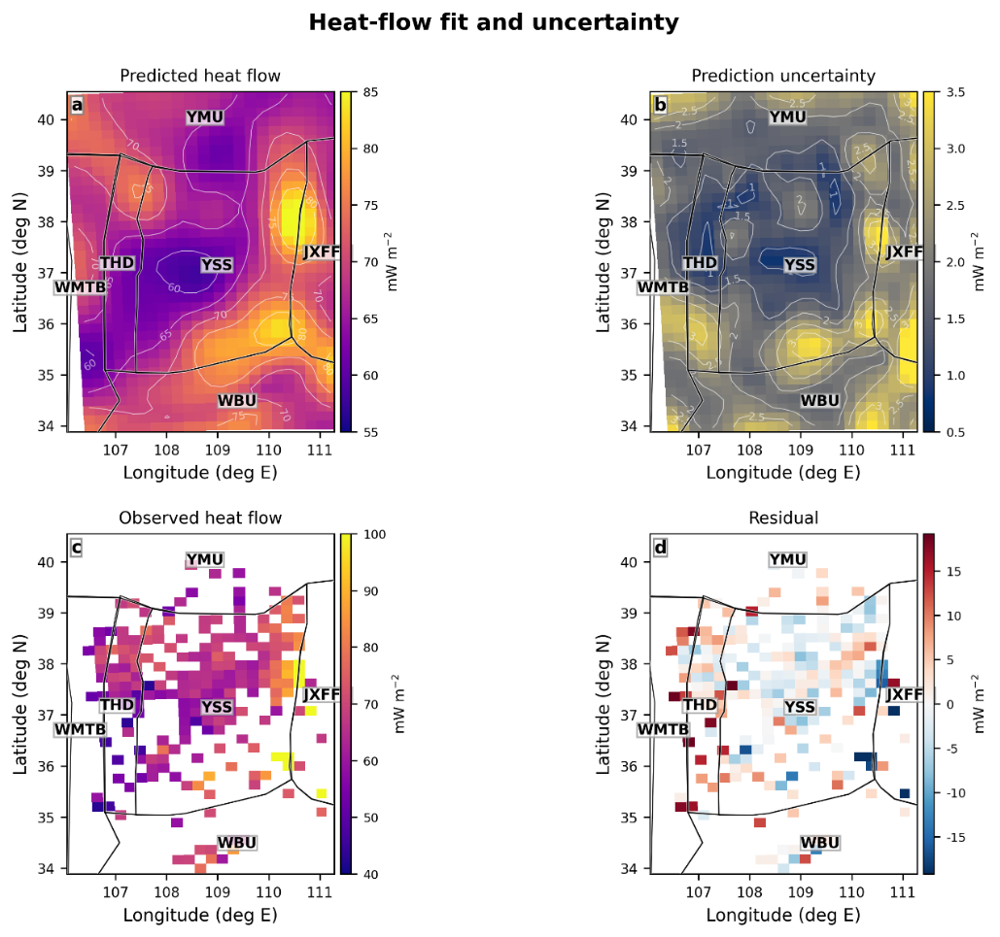

图 7 鄂尔多斯盆地地表预测热流、不确定性、观测热流和残差

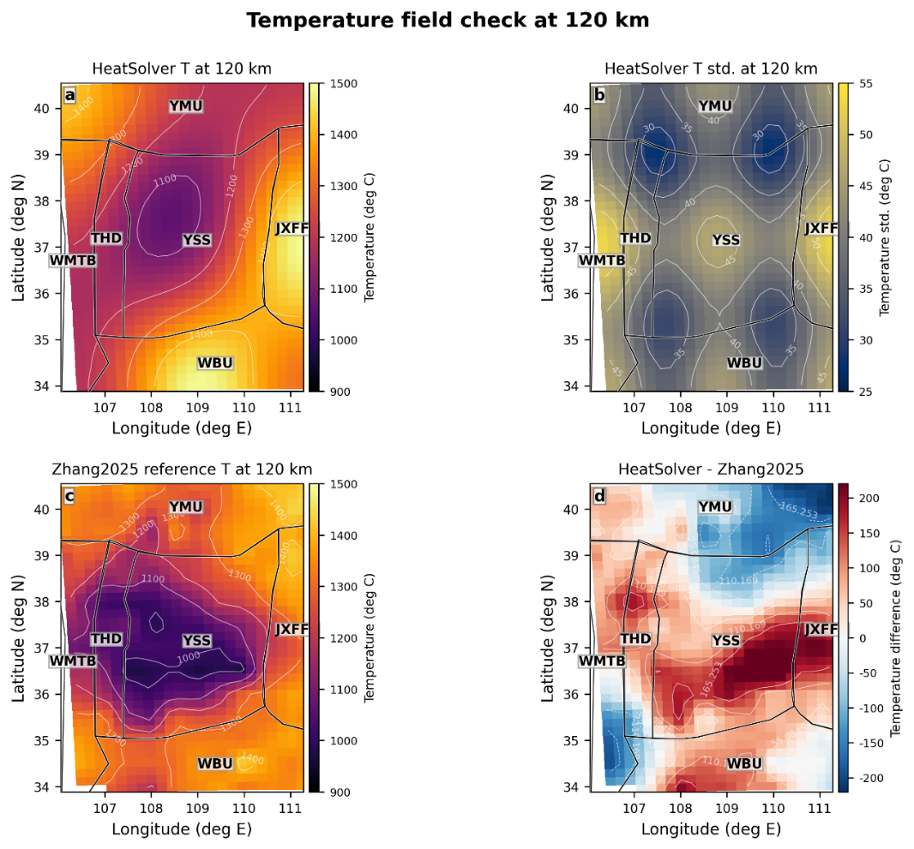

图 8 鄂尔多斯盆地 120 km温度场温度、集合标准差、Zhang 2025参考温度场及二者差值

## 三、课题的主要结论

### **1. 结果讨论**

#### **1.1 壳幔热流分配与深部热改造指示**

基于HeatSolver反演的生热率结构，将地表热流分解为地壳放射性生热积分和莫霍面热流输入两部分（图 9）。盆地整体地表热流均值为69.3 mW m⁻²，其中地壳生热贡献40.2 mW m⁻²（约58%），莫霍面热输入29.1 mW m⁻²（约42%），壳幔热流比约1.38，整体符合鄂尔多斯盆地“热壳冷幔”的认识。

然而，构造单元间差异显著。YSS、YMU和THD的莫霍面热流较低（约27 mW m⁻²，占比40%），地壳生热贡献约40 mW m⁻²，地表热流主要由地壳放射性元素衰变维持，呈现典型的稳定克拉通热结构。WBU和JXFFB的莫霍面热流分别升高至33.7和32.4 mW m⁻²，地幔热流占比达到46.9%，局部最高可达56.7%，表明南缘和东缘的高地表热流包含显著的深部热输入贡献，与温度场中80–120 km深度的高温异常相互印证。

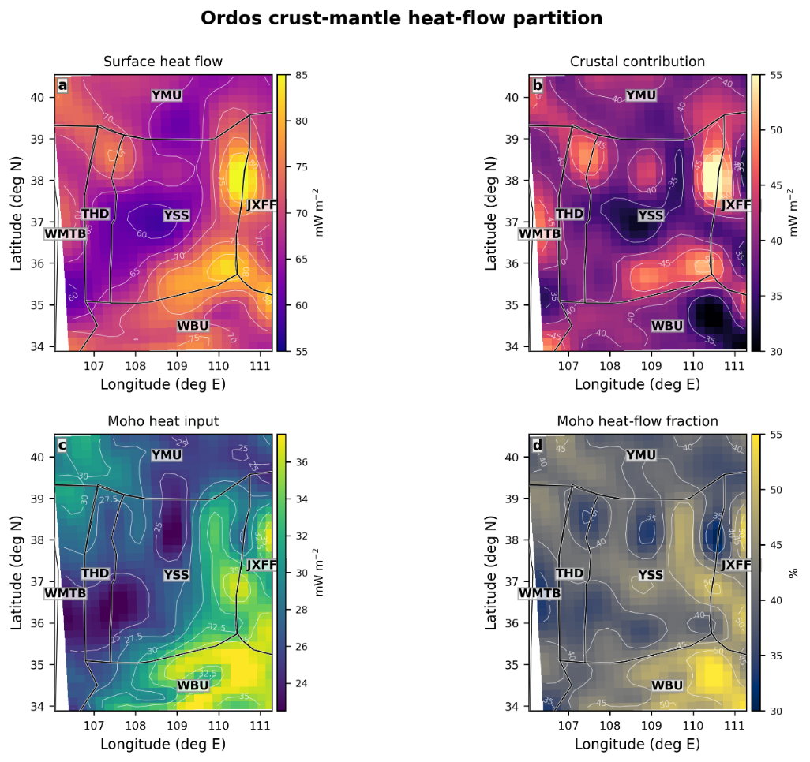

图 9 鄂尔多斯壳幔热流分解图：地表热流、地壳生热贡献、莫霍面热输入和地幔热流占比

上述壳幔热流分配的空间分异表明，盆地主体仍维持低地幔热流的克拉通特征，而南缘和东缘已过渡为地幔热流占比显著升高的状态。这提示华北克拉通岩石圈破坏的热效应可能已延伸至鄂尔多斯盆地的南缘和东缘，而非局限于盆地外围的造山带，与华北克拉通岩石圈结构的最新研究证据相符(Zhang et al., 2025)。

#### **1.2 沉积盖层对浅部热结构影响**

鄂尔多斯盆地浅层温度场同样表现出显著的构造单元间差异，其成因需要与沉积盖层的作用一并考虑。E-F浅部剖面（图 10）显示，WBU一侧沉积层厚、界面起伏强，浅部等温线密集、地温梯度高；YSS和YMU浅部地层平缓，等温线平直。低热导率沉积盖层具有"热毯效应"，在相同底部热流下使浅部温度梯度增大。

对沉积层热贡献的定量分解（图 11）显示，各构造单元平均沉积厚度为2.85-5.71 km，对地表热流的直接生热贡献为4.18-7.40 mW m⁻²，占地壳放射性生热贡献的10.4%-18.4%。三叠系厚度大且分布广，是沉积层生热贡献的主要层位；WBU作为断陷盆地接受了巨厚的新生代沉积，其生热贡献达1.70 mW m⁻²，约占该单元沉积层贡献的23%。因此WBU浅部高温是深部热输入增强、低热导率盖层保温效应和沉积层自身生热三者叠加的结果，不应简单归因于单一热源。

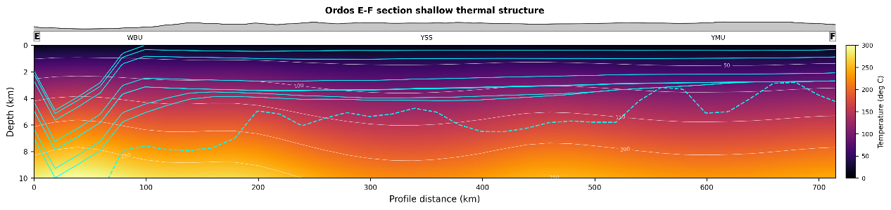

图 10 鄂尔多斯盆地 E-F浅部温度剖面，青线表示沉积层内部/底界，虚线显示主要等温线

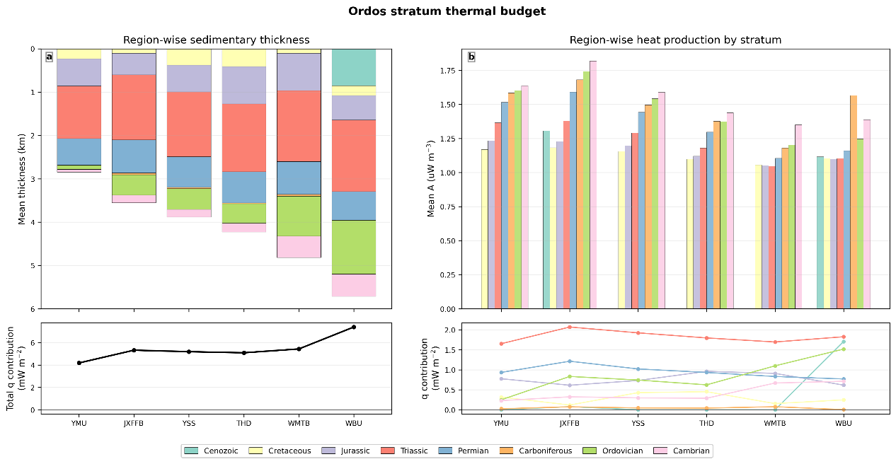

图 11 鄂尔多斯盆地各区域平均沉积厚度、分层生热率和各层热流贡献

### **2. 主要结论**

（1）PINN正演模型表明，将三维稳态热传导方程与多源地球物理观测融合建模岩石圈热结构是可行的。模型重建了华北克拉通西冷东热的一级格局，SHAP分析证实Vp和Vs贡献最大，且响应方向与岩石物理认知一致。

（2）HeatSolver以20 km × 20 km × 2 km分辨率获得了鄂尔多斯盆地0–120 km深度的三维温度场和热物性结构。预测热流与观测热流整体吻合，120 km温度场与独立参考模型在一级格局上一致。

（3）鄂尔多斯盆地热结构表现出清晰的空间分区：盆地主体（YSS–THD）保持低温、低地幔热流的稳定克拉通特征；南缘WBU和东缘JXFFB表现为深部持续高温、地幔热流占比升高（局部达56.7%），已接近热改造岩石圈状态。华北克拉通岩石圈破坏的热效应可能已延伸至鄂尔多斯盆地南缘和东缘，破坏边界较此前认识更偏西。

（4）沉积盖层对浅部热结构具有不可忽略的调制作用，各单元沉积层生热贡献占地壳生热的10%–18%，WBU浅部高温是深部热输入、盖层保温和沉积层生热三者叠加的结果。

### **3. 创新点与主要成果**

本研究的创新点体现在三个方面。第一，构建了PINN热传导正演模型，在物理方程约束下融合多源地球物理观测，并通过SHAP可解释性分析为数据-物理融合建模提供了方法验证。第二，发展了HeatSolver参数化反演框架，通过可微分有限差分求解器和DCT低频参数化，将热导率、生热率和底部温度边界纳入反演，突破了传统方法依赖固定经验参数的局限。第三，在鄂尔多斯盆地尺度上定量导出了壳幔热流分配和沉积层热预算，为识别盆地边缘岩石圈热改造提供了热学证据。

项目成果包括：HeatSolver三维热结构反演框架及鄂尔多斯盆地热结构模型，相关代码和数据已在GitHub（https://github.com/frontecho/HeatSolver）开源；PINN部分成果以海报形式在AGU会议上展示。

### **4. 不足与展望**

本研究仍有以下不足。第一，多源数据对反演精度的具体提升幅度尚未通过消融实验系统量化，且热导率、生热率与底部温度之间存在参数补偿效应，后续应通过逐类数据移除实验和更严格的先验约束加以厘清。第二，当前不确定性估计主要反映集合成员间的离散程度，尚未充分涵盖输入数据误差和边界条件扰动的传播，未来可通过贝叶斯反演或蒙特卡洛扰动给出更完整的评估。后续若进一步补充井温约束并更新深部地球物理模型，该框架有望为华北克拉通西部岩石圈改造和盆地热演化研究提供更可靠的定量约束。

## 四、参考文献

黄方, 何丽娟, 吴庆举, 2015. 鄂尔多斯盆地深部热结构特征及其对华北克拉通破坏的启示\[J/OL\]. 地球物理学报(58): 3671-3686. DOI:10.6038/cjg20151020.

王一波, 刘绍文, 陈超强, 等, 2024. 中国陆域大地热流数据汇编 (第五版)\[J\]. 地球物理学报, 67(11): 4233-4265.

AFONSO J C, FULLEA J, GRIFFIN W L, et al., 2013. 3-D multiobservable probabilistic inversion for the compositional and thermal structure of the lithosphere and upper mantle. I: a priori petrological information and geophysical observables\[J\]. Journal of Geophysical Research: Solid Earth, 118(5): 2586-2617.

ALJUBRAN M J, HORNE R N, 2024. Thermal Earth model for the conterminous United States using an interpolative physics-informed graph neural network\[J\]. Geothermal Energy, 12(1): 25.

DONALD L. T, SCHUBERT G, 2002. Geodynamics\[M\]. Cambridge university press.

FULLEA J, FERNÀNDEZ M, ZEYEN H, 2008. FA2BOUG—A FORTRAN 90 code to compute Bouguer gravity anomalies from gridded free-air anomalies: Application to the Atlantic-Mediterranean transition zone\[J\]. Computers & Geosciences, 34(12): 1665-1681.

GAO P, QIU Q, JIANG G, et al., 2018. Present-day geothermal characteristics of the Ordos Basin, western North China Craton: new findings from deep borehole steady-state temperature measurements\[J\]. Geophysical Journal International, 214(1): 254-264.

GEBCO Compilation Group (2025). GEBCO 2025 Grid\[DS/OL\]. DOI:doi:10.5285/37c52e96-24ea-67ce-e063-7086abc05f29.

GUO Z, AFONSO J C, QASHQAI M T, et al., 2016. Thermochemical structure of the North China Craton from multi-observable probabilistic inversion: Extent and causes of cratonic lithosphere modification\[J\]. Gondwana Research, 37: 252-265.

HAO A, ZHANG H, LIU L, et al., 2025. Cenozoic destruction of eastern North China Craton evidenced by seismically imaged lithosphere delamination and Nd isotopes\[J/OL\]. The Innovation Geoscience, 3(3): 100144-10. DOI:10.59717/j.xinn-geo.2025.100144.

ISHITSUKA K, ISHIZU K, WATANABE N, et al., 2025. Reliable and Practical Inverse Modeling of Natural-State Geothermal Systems Using Physics-Informed Neural Networks: Three-Dimensional Model Construction and Assimilation With Magnetotelluric Data\[J\]. Journal of Geophysical Research: Machine Learning and Computation, 2(3): e2025JH000683.

LI B, AFONSO J C, YANG D, et al., 2026. Imaging lithosphere–asthenosphere interaction beneath the North China Craton: Implications for intraplate volcanism and anomalous basin subsidence\[J\]. Earth and Planetary Science Letters, 685: 120026.

LUNDBERG S, LEE S I, 2017. A Unified Approach to Interpreting Model Predictions\[EB/OL\]. (2017-05-22)\[2026-05-29\]. https://arxiv.org/abs/1705.07874v2.

MAUS S, BARCKHAUSEN U, BERKENBOSCH H, et al., 2009. EMAG2: A 2–arc min resolution Earth Magnetic Anomaly Grid compiled from satellite, airborne, and marine magnetic measurements\[J\].

QI K, REN Z, CUI J, et al., 2025. Present-day deep geothermal field and lithospheric thermal structure in the Ordos Basin\[J\]. Geothermics, 125: 103198.

SHI Y, XU Y, YANG B, et al., 2022. Lithospheric Conductors Shed Light on the Non-Uniform Destruction of North China Craton\[J\]. Journal of Geophysical Research: Solid Earth, 127(3): e2021JB022587.

SHIMA A, ISHITSUKA K, LIN W, et al., 2024. Modeling unobserved geothermal structures using a physics-informed neural network with transfer learning of prior knowledge\[J\]. Geothermal Energy, 12(1): 38.

SUN Y, DONG S, WANG X, et al., 2022. Three-Dimensional Thermal Structure of East Asian Continental Lithosphere\[J\]. Journal of Geophysical Research: Solid Earth, 127(5): e2021JB023432.

WANG K, XIONG X, ZHOU Y, et al., 2020. Three-dimensional thermo-rheological structure of the lithosphere in the North China Craton determined by integrating multiple observations: Implications for the formation of rifts\[J\]. Science China Earth Sciences, 63(7): 969-984.

WANG Y, CHEN L, YANG G, et al., 2021. The late Paleoproterozoic to Mesoproterozoic rift system in the Ordos Basin and its tectonic implications: Insight from analyses of Bouguer gravity anomalies\[J\]. Precambrian Research, 352: 105964.

XIAO X, CHENG S, WU J, et al., 2024. CSRM-1.0: A China Seismological Reference Model\[J\]. Journal of Geophysical Research: Solid Earth, 129(9): e2024JB029520.

YAN D, TIAN Y, ZHAO D, et al., 2019. Upper mantle temperature structure of the North China Craton\[J\]. Physics of the Earth and Planetary Interiors, 293: 106269.

YANG P, REN Z L, FU J H, et al., 2024. A tectono-thermal perspective on the petroleum generation, accumulation and preservation in the southern Ordos Basin, North China\[J/OL\]. Petroleum Science, 21(3): 1459-1473. DOI:10.1016/j.petsci.2023.12.006.

YANG X, LI Y, AFONSO J C, 2025. Distinct destruction mechanism in the North China Craton: Insight from high-resolution thermochemical structure\[A/OL\]. Rochester, NY: Social Science Research Network\[2025-11-23\]. https://papers.ssrn.com/abstract=5638814.

ZHANG A, CHU R, ZHOU P, et al., 2025. Extent and Mechanisms of the North China Craton Lithospheric Destruction Revealed by Multi-Geophysical Inversions\[J\]. Journal of Geophysical Research: Solid Earth, 130(4): e2025JB031104.

ZHANG C, GUO Z, YU Y, et al., 2022. Distinct Lithospheric Structures of the Ordos Block and Its Margins From P and S Receiver Functions and Its Implications for the Cenozoic Lithospheric Reworking\[J/OL\]. Geophysical Research Letters, 49(6): e2021GL097680. DOI:10.1029/2021GL097680.

ZHAO B, MAO K, CAI Y, et al., 2019. A combined Terra and Aqua MODIS land surface temperature and meteorological station data product for China from 2003–2017\[DS/OL\]. Zenodo\[2026-05-29\]. https://zenodo.org/records/3528024. DOI:10.5281/zenodo.3528024.

